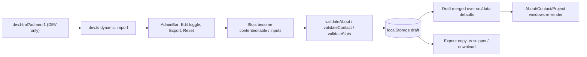

Status: needs-triage (awaiting "Approved")

# Admin mode: in-browser copy editor

Owner edits About, Contact and Project slots live on the Dev Desktop, then exports the result into `src/data/`. The tool never generates copy (AGENTS.md); it only edits what the owner types.

## Decisions (from the owner)
- Purpose: copy editor with export. Not a CMS, no backend, no auth.
- Access: URL flag `?admin=1`, **dev build only** (`import.meta.env.DEV`). Production builds dead-code-strip it, so visitors never get it and the Desktop JS budget (350 KB gzip) is unaffected. Admin code is loaded via dynamic `import()`.
- Persistence: drafts in `localStorage` (key `portfolio-admin-draft-v1`), plus Export.

## Flow


## Interfaces
```ts
interface AdminDraft {
  version: 1;
  about?: Partial<AboutSlots>;
  contact?: Partial<ContactSlots>;
  /** keyed by ProjectEntry.slug */
  projects?: Record<string, Partial<ProjectSlots>>;
}

interface AdminStore {
  load(): AdminDraft;
  save(draft: AdminDraft): void;
  reset(): void;
}

/** Pure: applies a draft over the committed data. */
function applyDraft<T>(base: T, patch: Partial<T> | undefined): T;

/** Pure: renders the draft as TypeScript source for src/data/{about,contact,projects}.ts. */
function exportDraft(draft: AdminDraft): { about: string; contact: string; projects: string };

interface AdminSlotIssue { path: string; message: string }  // from existing validators

function mountAdmin(ctx: { desktop: DesktopController }): void;  // only called when DEV && ?admin=1
```

## Wireframe
```
+-- ADMIN ----------------------------------------------+
| [ Edit: ON ]  [ Export ]  [ Reset draft ]   2 issues   |
+--------------------------------------------------------+
  Window slots show a dashed phosphor outline while Edit is ON.
  Click a slot -> edit in place. Limit counters (e.g. 112/220) beside the slot.
  Invalid slot: outline turns amber + issue listed in the bar.
```

## Scope
- Editable: About (heading, bio, secondary, stack groups/tags, copyright), Contact (all slots), Project slots (all `ProjectSlots`, including Deep dive and Challenges blocks).
- Not editable: stage specs, slugs, window layout, GITHUB_URL.
- Placeholder `[ ... ]` markers stay until the owner types over them; clearing a slot to empty restores the marker.
- Export output is the owner's text verbatim.

## Tickets (proposed)
1. `AdminStore` + `applyDraft` + `exportDraft` (pure, Vitest).
2. DEV gate and `AdminBar`; confirm production build contains no admin code and budget is unchanged.
3. Contact window editing (smallest, proves the pattern).
4. About window editing, including Stack groups.
5. Project window editing, including write-up blocks.
6. Export UI, Reset, validation display, browser check at 375/768/1024.

## Acceptance
- `npm run build` zero errors; production `dist` has no admin strings; Desktop JS budget still passes.
- `npm test` passes, with tests for `applyDraft`, `exportDraft` and store round-trip.
- Without `?admin=1`, or in a production build, behavior is identical to today.
- Browser-checked with screenshots at 375/768/1024.
