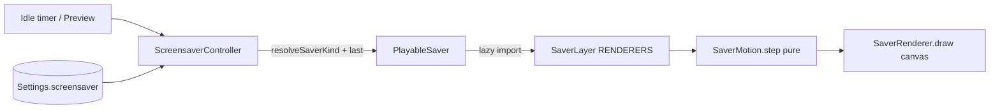

# Spec: More Screensavers (8 new savers, grouped list, Random)
Status: ready-for-agent
Approval: Approved by the user 2026-11-18.
Branch: `feat/more-savers`, cut after the user commits the Drone Patrol removal on `feat/settings-panel`.

Vocabulary follows `GLOSSARY.md`: Desktop, Taskbar, Settings panel, Screensaver, Phosphor color, CRT filter, Project stage, Hero name.

## Problem Statement

The Settings panel offers three Screensavers. The owner wants more to discover: savers that look at home on a monochrome CRT, and savers that quietly show off game-systems work (pathfinding, cellular automata, procedural routing) or tie in with the coming Drone side (contours, radar, terrain). With three times as many savers, the flat list in the panel also stops being easy to scan.

## Solution

Eight new Screensavers, all drawn in the visitor's Phosphor color on black and all following the existing saver rules (a seeded, pure motion plus a renderer; a calm variant under reduced motion; a plain fade on exit):

| Working label | Group | What it shows |
|---|---|---|
| Oscilloscope | Signal | A single beam traces slowly morphing Lissajous figures; old frames fade like phosphor persistence. |
| Harmonograph | Signal | A pen on decaying pendulums draws a spiral that settles; the drawing fades and a new seed begins. |
| Pathfinder | Systems | A maze is carved, then A\* floods its frontier dimly and traces the found path at full brightness; repeat. |
| Life | Systems | The Hero name's letters become live cells and run under Conway's rules; when the board stalls or after ~60s it fades and re-seeds from the name. |
| Circuit | Systems | Traces grow across a grid with 45° bends and pad dots, like a board routing itself; when full it fades and restarts. |
| Contours | Flight | Contour lines over a slowly evolving height field (marching squares). |
| Radar | Flight | A rotating sweep arm with a fading wake; unlabeled blips drift slowly, brighten as the arm passes, then fade. |
| Terrain | Flight | Wireframe ridgelines rush toward the viewer, vector-display style, with a hand-rolled 2D projection (no Three.js). |

Plus a **Random** choice: each time the Screensaver starts it picks any of the 11 savers, never the same one twice in a row within one page visit. **Line trace stays the default.**

Labels and group headings above are working placeholders; the user will rename them.

Wireframe (Settings panel, Screensaver group; two columns on desktop, phone sheet keeps two columns):

```
SCREENSAVER
 CLASSIC                      SIGNAL
  ( ) Letter drift             ( ) Oscilloscope
  (•) Line trace               ( ) Harmonograph
  ( ) Bouncing name
 SYSTEMS                      FLIGHT
  ( ) Pathfinder               ( ) Contours
  ( ) Life                     ( ) Radar
  ( ) Circuit                  ( ) Terrain
 ( ) Random   ( ) None
 Wait  [30s][1m][5m]  [Preview]
```

## User Stories

1. As a visitor, I want more Screensavers to choose from, so that leaving the Desktop idle keeps surprising me.
2. As a visitor, I want the saver list grouped under short headings, so that I can scan twelve choices quickly.
3. As a visitor on a phone, I want the grouped list to fit the bottom sheet without sideways scrolling, so that choosing is easy one-handed.
4. As a keyboard visitor, I want the radios to stay one radio group with arrow-key movement across all groups, so that headings don't break navigation.
5. As a screen-reader visitor, I want each group announced by its heading, so that I know which family a saver belongs to.
6. As a visitor, I want Oscilloscope to trace glowing Lissajous figures with fading trails, so that the screen feels like a real CRT beam.
7. As a visitor, I want Harmonograph to draw a settling spiral and then start a fresh one, so that it never looks the same twice.
8. As a visitor, I want Pathfinder to carve a maze, show the search spreading and then light up the path, so that I see the owner's game-AI chops.
9. As a visitor, I want Life to start from the Hero name and break it into gliders and oscillators, so that the name becomes a living system.
10. As a visitor, I want Life to bring the name back after the board stalls or about a minute passes, so that the name keeps returning.
11. As a visitor, I want Circuit to route traces with 45° bends and pads, so that it reads as a board designing itself.
12. As a visitor, I want Contours to show slowly shifting topographic lines, so that the Dev side hints at the Drone side.
13. As a visitor, I want Radar to sweep with a fading wake and unlabeled blips, so that it feels like flight ops without any invented text.
14. As a visitor, I want Terrain to fly me over wireframe ridges, so that idle time feels like a low pass over a vector landscape.
15. As a visitor, I want every new saver drawn in my chosen Phosphor color, so that Amber, White or Blue apply everywhere.
16. As a visitor with the CRT filter on, I want the new savers to sit under the same overlay rules as the existing ones, so that the look is consistent.
17. As a visitor who prefers reduced motion, I want each new saver to run at about a tenth of its speed with fades instead of sudden changes, so that nothing flashes or rushes.
18. As a visitor, I want any input to end a new saver with the usual short fade, so that returning to the Desktop feels the same for all savers.
19. As a visitor, I want to pick Random, so that I see a different saver each time the screen goes idle.
20. As a visitor on Random, I want never to see the same saver twice in a row, so that the shuffle feels like a shuffle.
21. As a visitor, I want Preview on Random to show a random saver too, so that Preview matches what idling will do.
22. As a returning visitor, I want my saver choice (including Random) remembered, so that I don't have to pick again.
23. As a returning visitor whose stored choice is unknown or removed, I want it to fall back to Line trace, so that nothing breaks.
24. As a first-time visitor, I want Line trace as the default, so that nothing changes for people who never open Settings.
25. As a visitor on a large or small screen, I want each saver to scale to the viewport and keep everything on screen, so that nothing is cropped.
26. As a visitor who resizes the window while a saver runs, I want it to keep drawing correctly, so that it doesn't smear or stretch.
27. As a visitor on a modest laptop or phone, I want the savers to run smoothly, so that the fan doesn't spin up while I'm away.
28. As the owner, I want the Desktop's first-load JS to stay within budget, so that new savers cost nothing until one runs.
29. As the owner, I want the labels and headings to be placeholders I can rename, so that I keep writing all site copy.
30. As the owner, I want each saver's motion tested deterministically, so that later changes don't silently break it.

## Implementation Decisions

- **Same extension point.** Each saver is a pure, seeded `SaverMotion<S>` (step-based, `calm` flag) plus a `SaverRenderer<S>` drawing to a 2D canvas, registered as one `RENDERERS` line in the lazy saver layer. All new code lives in the lazy saver chunk; nothing new is statically imported by the Desktop entry.
- **New `ScreensaverKind` values:** `oscilloscope`, `harmonograph`, `pathfinder`, `life`, `circuit`, `contours`, `radar`, `terrain`, `random`. Added to `SCREENSAVERS`, the parser's allowed values, and the inline head script in `dev.html` that mirrors them (version stays `v:1`; unknown values already fall back to the default).
- **Default fix:** `DEFAULT_SETTINGS.screensaver` is already `lineTrace`; `GLOSSARY.md` wrongly names Letter drift as the default. The Screensaver entry is corrected and extended (eight new savers, Random).
- **Random is resolved at start, not stored.** The controller resolves `random` to a concrete kind just before starting the layer; `none` and `random` are never picked. "Last shown" is kept in memory for the page visit only.
- **Phosphor color** is read once from the `--phosphor` token at mount and on each draw-time resize, as the existing views do.
- **Persistence look** (Oscilloscope, Harmonograph, Radar wake) uses a translucent black fill each frame rather than storing long trails in state; the motion still owns the beam/pen position so it stays testable.
- **Life's seed pattern** comes from a small hand-authored bitmap of the Hero name's letters (pure data, no DOM text rasterizing), so the motion stays pure and testable. Cell size scales with the viewport so the name spans most of the width.
- **Terrain** uses a hand-rolled perspective projection over a scrolling height grid; Three.js stays Gateway-only.
- **Calm rule:** time-scale ~0.1 and every reset, re-seed or new path fades in/out instead of cutting. Life steps at most once every few seconds when calm.
- **Exit:** no `exit()` on the new renderers; the layer's 250ms fade applies.
- **Panel markup:** the Screensaver fieldset keeps one `name="screensaver"` radio group; groups are visual sub-sections with headings (aria-labelled), laid out by a two-column grid that holds at 375px.

Interfaces (no bodies):

```ts
type ScreensaverKind =
  | 'letterDrift' | 'lineTrace' | 'bouncingName'
  | 'oscilloscope' | 'harmonograph'
  | 'pathfinder' | 'life' | 'circuit'
  | 'contours' | 'radar' | 'terrain'
  | 'random' | 'none';

/** A kind the saver layer can actually draw (excludes 'random' and 'none'). */
type PlayableSaver = Exclude<ScreensaverKind, 'random' | 'none'>;

/** Pure: picks the saver to show for `kind`. 'random' picks uniformly from `pool` minus `last`; others pass through. */
declare function resolveSaverKind(
  kind: ScreensaverKind,
  last: PlayableSaver | null,
  rand: () => number,
  pool: readonly PlayableSaver[],
): PlayableSaver | null;

// One pair per saver, e.g.:
declare const oscilloscope: SaverMotion<OscilloscopeState>;
declare const oscilloscopeView: SaverRenderer<OscilloscopeState>;
```



## Testing Decisions

- **Seams:** (1) each saver's `SaverMotion` (pure `init`/`step` with a fixed seed and viewport), (2) `resolveSaverKind`, (3) the Settings parser. No new seams beyond these; renderers are checked in the browser.
- Good tests assert external behavior only: same seed → same state; everything stays inside the viewport across thousands of steps and after a resize; bounded state size (no unbounded trail arrays); calm runs at roughly a tenth of the pace; resets happen (Harmonograph re-seed, Life re-seed after stall or ~60s, Circuit/Pathfinder restart when done).
- Saver-specific checks: Pathfinder's path is connected, starts at the start cell and ends at the goal, and only passes through open cells; Life's first generation equals the name pattern and follows Conway's rules on a known still life/blinker; Contours' marching-squares segments lie on the iso-level within tolerance; Radar blips have no text and stay in the scope circle; Terrain's projected points stay finite and in view.
- `resolveSaverKind`: never returns `last` when the pool has more than one, never returns `random`/`none`, passes concrete kinds through, returns null for `none`.
- Settings: `random` and each new kind round-trip; unknown values fall back to `lineTrace`.
- Prior art: `LineTrace.test.ts`, `LetterDrift.test.ts`, `BouncingName.test.ts`, `Screensaver.test.ts`, `Settings.test.ts`.
- Browser: each saver previewed at 375 / 768 / 1440 in at least Green and Amber, CRT on, plus reduced motion; zero console errors; Desktop budget printed by the build stays flat.

## Out of Scope

- Final labels and group headings (the user writes them).
- Labeled radar blips or any other on-screen text in savers.
- Interactive savers (any input still ends the saver).
- Saver-specific exit animations for the new eight.
- Per-saver options (speed, density) in the panel.
- Audio for savers.
- The Drone side itself.

## Further Notes

- Suggested ticket slicing: one ticket for `random` + new kinds + grouped panel + glossary; then one ticket per saver (8), each independent once the first lands.
- Persistence-by-fill means the renderer must clear fully on resize so a smeared old frame doesn't remain.


## Change after approval (2026-11-18)

The user removed Oscilloscope, Harmonograph and Radar (so the Signal group is gone) and the existing Letter drift saver. Stored settings naming a removed kind fall back to the default.
