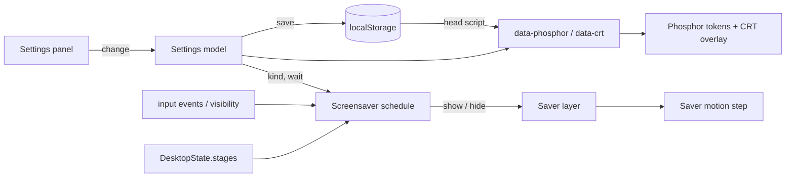

# Spec: Settings panel (Screensaver, Phosphor color, CRT filter)
Status: ready-for-agent
Approval: waiting for the user's "Approved" before `/to-tickets`.

Vocabulary follows `GLOSSARY.md`: Desktop, Taskbar, Power menu, Settings panel, Screensaver, Phosphor color, CRT filter, Project stage, Boot shell, Outline trace, Hero name, Gateway.

## Problem Statement

The Desktop has nothing for visitors to play with beyond the windows themselves. The owner wants a few fun, OS-flavoured things to discover, gathered in one place. The glossary already describes a Screensaver, but none exists in the code.

## Solution

A Settings button at the right end of the Taskbar, next to the clock, opens the **Settings panel**: a flyout above the button on the desktop layout and a bottom sheet on the phone layout. It holds three groups:

- **Screensaver**: Letter drift (default), Line trace, Bouncing name, Drone patrol or None; a wait of 30s / 1m / 5m; a Preview button.
- **Phosphor color**: Green (default), Amber, White, Blue. Applies across the whole Dev portfolio: Desktop, Screensaver, CRT tint, and on later visits the Boot shell and Outline trace. The settled Hero name stays `#F0F4F8`; the Gateway is untouched.
- **CRT filter** (revised 2026-11-18): an on/off switch, **on** by default, with one look (the former High step: 2px scanlines, vignette, 4s flicker). It covers the whole Dev portfolio, the Power menu, the Settings panel and the pointer (a drawn Phosphor cursor on fine pointers). Stored `low`/`med`/`high` read as on.

The visitor's choices are remembered on their next visit. A Reset to defaults link sits at the bottom of the panel.

Wireframe (desktop layout):

```
┌─ SETTINGS ──────────────────────┐
│ SCREENSAVER                     │
│  (•) Letter drift   ( ) None    │
│  ( ) Line trace                 │
│  ( ) Bouncing name              │
│  ( ) Drone patrol               │
│  Wait  [30s][1m][5m]  [Preview] │
│ PHOSPHOR                        │
│  [■ Green][■ Amber][■ White][■ Blue] │
│ CRT FILTER                      │
│  Filter                  [■ on] │
│                Reset to defaults│
└─────────────────────────────────┘
[⏻] [Hero][Projects]…        [⚙] 14:02
```

Panel and option labels above are interface labels, not owner copy. They are provisional, and the user may rename them.

## User Stories

1. As a visitor, I want a Settings button at the right end of the Taskbar, so that I can find the fun options without them cluttering the Desktop.
2. As a visitor, I want the Settings panel to open above the button and close on Escape, an outside click or a second press, so that it behaves like the Power menu.
3. As a keyboard visitor, I want to open the panel, move between its controls with Tab and the arrow keys, and have focus go back to the button when it closes, so that I never lose my place.
4. As a screen-reader visitor, I want each group announced as a labelled group of radio buttons or a slider, with the current value, so that I know what I'm changing.
5. As a phone visitor, I want the panel as a bottom sheet with thumb-sized controls, so that it fits the taller phone Taskbar.
6. As a visitor, I want to pick one of four Screensavers or None, so that I can choose the idle show I like.
7. As a first-time visitor, I want Letter drift as the default Screensaver, so that the Desktop has an idle show without any setup.
8. As a visitor, I want to choose a wait of 30s, 1m or 5m, so that the Screensaver starts when it suits me.
9. As a visitor, I want a Preview button that shows the selected Screensaver right away, so that I don't have to sit idle to see it.
10. As a visitor, I want any mouse move, key, touch or scroll to end the Screensaver and return the Desktop exactly as I left it, so that it never costs me anything.
11. As a visitor watching a Project stage, I want the Screensaver held off while the stage is playing, so that it never covers a demo or video.
12. As a visitor, I want the Screensaver to stop counting while the tab is hidden, so that I don't come back to one already running.
13. As a visitor, I want Letter drift to pull the Hero name's letters apart over black and bring them back together when I return.
14. As a visitor, I want Line trace to draw phosphor lines that turn at right angles across the screen and slowly fill it before starting over.
15. As a visitor, I want Bouncing name to send the Hero name bouncing off the screen edges, and something to mark the rare moment it hits a corner exactly.
16. As a visitor, I want Drone patrol to show a small wireframe drone flying lazy loops, as a teaser for the Drone side.
17. As a visitor, I want to switch the Phosphor color to Amber, White or Blue, so that the Desktop looks like a different old monitor.
18. As a visitor, I want the Phosphor color to change at once everywhere on the Desktop, including open windows, the Taskbar, the panel itself and the Screensaver, so that the look stays consistent.
19. As a returning visitor, I want the Boot shell and Outline trace drawn in my chosen Phosphor color, so that the whole visit matches.
20. As a visitor, I want the settled Hero name to stay its usual off-white, so that the identity mark looks the same in every color.
21. As a visitor, I want the CRT filter on by default and a switch to turn it off, so that the retro look is there unless I don't want it.
22. As a visitor, I want the CRT filter to leave every control clickable and all text readable at every step, so that the effect never gets in the way.
23. As a visitor sensitive to motion, I want no flicker and calm, near-still Screensavers when my system is set to reduce motion, so that the fun options stay comfortable.
24. As a returning visitor, I want my Screensaver, wait, Phosphor color and CRT switch remembered, so that I don't set them up again.
25. As a visitor whose browser blocks storage, I want the panel to still work for the current visit, falling back to defaults, so that nothing breaks.
26. As a visitor, I want a Reset to defaults link, so that I can undo everything in one step.
27. As the owner, I want the Gateway unaffected by any setting, so that the first impression always looks as designed.
28. As the owner, I want the Desktop JS budget kept and Three.js kept off the Dev portfolio, so that the fun options don't slow the first visit.
29. As the owner, I want the settings to have no deep link and no Back entry, so that the address bar stays about windows, not preferences.

## Implementation Decisions

- **Placement**: a new Taskbar button between the open-window buttons and the clock. It is a popover invoker like the Power menu button and uses the same open, close, focus-return and fallback approach. It is not a Desktop window: no `WindowId`, no Taskbar entry, no deep link, no Back.
- **Settings model** (pure, storage injected, prior art: `PersonaController` storage guards):

  ```ts
  type ScreensaverKind = 'letterDrift' | 'lineTrace' | 'bouncingName' | 'dronePatrol' | 'none';
  type IdleWait = 30 | 60 | 300; // seconds
  type PhosphorColor = 'green' | 'amber' | 'white' | 'blue';
  type CrtStrength = 'off' | 'low' | 'med' | 'high';

  interface Settings {
    screensaver: ScreensaverKind;
    wait: IdleWait;
    phosphor: PhosphorColor;
    crt: CrtFilter; // 'on' | 'off'
  }

  interface SettingsStorage { read(): string | null; write(value: string): void; }

  declare const DEFAULT_SETTINGS: Settings; // letterDrift, 60, green, off
  declare function parseSettings(raw: string | null): Settings;        // invalid fields fall back one by one
  declare function serializeSettings(s: Settings): string;              // versioned JSON
  declare function loadSettings(storage: SettingsStorage): Settings;   // throws never
  declare function saveSettings(storage: SettingsStorage, s: Settings): void; // swallows storage errors
  ```

  The default wait is 1m. Storage holds one versioned key, so an unknown version is read as defaults.
- **Applying settings**: the root element carries `data-phosphor` and `data-crt`. The `--desk-green*` tokens move to neutral phosphor tokens (one base color plus mid, dim and faint alphas), with one value set per Phosphor color. Every hard-coded `#00ff41` on the Dev portfolio's styles moves to those tokens. The settled Hero name keeps `#F0F4F8`. The Gateway's styles are not touched.
- **Boot shell and Outline trace**: a tiny inline head script on the Dev page reads the stored Phosphor color and sets `data-phosphor` before first paint, so the Boot shell never flashes green first. It runs before any module, with a try/catch for blocked storage.
- **CRT filter**: one fixed overlay that ignores pointer events, drawing scanlines with a repeating gradient and a vignette, with a slow flicker removed under `prefers-reduced-motion`. It is a manual popover kept at the top of the top layer (re-shown whenever another popover opens), so it lies over the Power menu and Settings panel. On fine pointers the system pointer is hidden and a Phosphor cursor (arrow, hand, text bar, resize arrows) is drawn just beneath the overlay. Overlay and cursor hide while a Screensaver plays, so the filter never tints it. Text must stay readable.
- **Screensaver schedule** (pure, clock injected):

  ```ts
  interface IdleInputs {
    now: number; lastInputAt: number; wait: IdleWait;
    kind: ScreensaverKind; stagePlaying: boolean; hidden: boolean; previewing: boolean;
  }
  declare function screensaverShouldShow(i: IdleInputs): boolean;
  ```

  Previewing shows the saver regardless of the wait and `kind` (unless `none`) and ends on the next input. A playing Project stage, a hidden tab or `none` keep it off. `stagePlaying` comes from `DesktopState.stages` (any stage `loaded`). The idle timer is reset by `pointermove`, `pointerdown`, `keydown`, `wheel` and `touchstart` on the document, and by tab visibility returning. The input that ends a saver does not also click whatever is under it.
- **Saver motion** (pure, seeded, step-based; prior art: `HeroMotion`):

  ```ts
  interface SaverViewport { width: number; height: number; }
  interface SaverMotion<S> {
    init(seed: number, view: SaverViewport, calm: boolean): S;
    step(state: S, dtMs: number, view: SaverViewport): S;
  }
  declare const lineTrace: SaverMotion<LineTraceState>;       // right-angle turns, stays in bounds, resets when full
  declare const bouncingName: SaverMotion<BouncingNameState>; // reflects off edges; flags exact corner hits
  declare const dronePatrol: SaverMotion<DronePatrolState>;   // smooth looping path, stays in bounds
  declare const letterDrift: SaverMotion<LetterDriftState>;   // letters drift out, return on exit
  ```

  `calm` (reduced motion) gives a near-still frame that changes every few seconds, with no bouncing or flicker.
- **Saver rendering**: one full-screen layer above the Desktop. A 2D canvas draws Line trace and Drone patrol, and DOM text draws Letter drift and Bouncing name. Everything uses the current Phosphor color. Nothing on the Dev portfolio imports Three.js. The saver code is lazy-loaded the first time a saver starts or Preview is pressed, so it stays out of the Desktop's first-load budget.
- **Accessibility**: the panel groups are `fieldset`s with legends. Screensaver, wait and color are radio groups, and CRT is a checkbox with `role="switch"`. A running Screensaver is `aria-hidden`, and focus stays where it was.



## Testing Decisions

- Good tests drive the public functions with inputs and check the outputs. They never check internals, CSS strings or DOM structure.
- **Settings model**: defaults on `null`, corrupt JSON or an unknown version; a single invalid field falls back while the others are kept; round-trip through serialize and parse; `loadSettings` and `saveSettings` survive a storage that throws; Reset returns the defaults. Prior art: `PowerMenu.test.ts`, `PersonaController.test.ts`.
- **Screensaver schedule**: shows exactly at the wait boundary and not before; `none`, `stagePlaying` and `hidden` each keep it off; preview shows at once and works for every kind but `none`. Uses a fake clock. Prior art: `DesktopState.test.ts`.
- **Saver motion**: the same seed gives the same frames; every saver stays inside the viewport over many steps and after a resize; Line trace turns only at right angles and resets when full; Bouncing name reflects correctly and flags a corner hit when it reaches a corner; `calm` changes state no more often than its slow interval. Prior art: `HeroMotion.test.ts`.
- Canvas drawing, the CRT look and the colors are checked in the browser at 375 / 768 / 1024 and in landscape, with screenshots for each Phosphor color, CRT on and off, and each saver. Reduced motion and blocked storage get checked there too (`web-runtime-verification`).
- `npm run build` passes inside the Desktop JS budget, and `npm test` passes.

## Out of Scope

- The desktop pet drone, the Konami code, the achievements tracker, Hibernate, the hidden terminal, the BIOS screen and the other easter-egg ideas. They can later join the Settings panel.
- Sound settings or sound packs.
- Any setting on the Gateway or the Drone side.
- Syncing settings across devices.
- A Three.js Screensaver.

## Further Notes

- Line trace takes after the classic pipes-style screensaver but is its own flat 2D take: phosphor lines on black, not a copy of any existing screensaver's look.
- The Screensaver was in the glossary before any code existed. This spec is the first time it ships.
- The panel uses a popover with the same fallbacks the Power menu uses.
